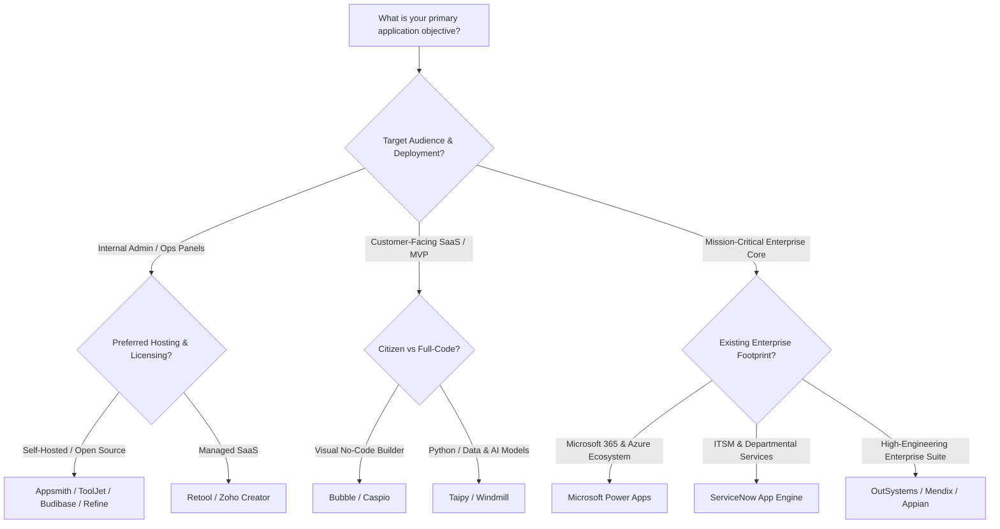

  

  
  
  
  
  
  

---

# 🚀 Awesome Low-Code Application Platform (LCAP) Ecosystem

A comprehensive, curated directory of the world's premier **Low-Code Application Platforms (LCAP)**, visual app builders, developer-friendly internal tool platforms, and self-hosted open-source software (OSS) development environments.

Whether you are an **Enterprise Architect** designing governance guardrails, a **Full-Stack Engineer** automating internal operations, or a **Citizen Developer** constructing mission-critical workflows, this list covers battle-tested solutions spanning hyperscaler SaaS suites and sovereign open-source codebases.

---

## 📑 Table of Contents

- [📊 Sector Overview & Market Dynamics](#-sector-overview--market-dynamics)
- [🏢 Enterprise SaaS & Hosted Platforms](#-enterprise-saas--hosted-platforms)
- [🔓 Open-Source GitHub Projects](#-open-source-github-projects)
- [🧭 Decision & Architecture Matrix](#-decision--architecture-matrix)
- [💡 Key Evaluation Criteria](#-key-evaluation-criteria)
- [🤝 How to Contribute](#-how-to-contribute)
- [💖 Support & Sponsorship](#-support--sponsorship)
- [📈 Star History](#-star-history)
- [⚖️ Disclaimer & License](#-disclaimer--license)

---

## 📊 Sector Overview & Market Dynamics

The global **Low-Code Application Platform (LCAP)** market was estimated at **$28.5 billion in 2024** and is projected to expand to **$102.8 billion by 2030**, compounding at an aggressive annual growth rate (**CAGR of ~28.4%**), driven by surging demand for AI-augmented software creation, hyper-automation, and the enterprise need to bridge engineering backlogs.

The industry exhibits a **moderately fragmented "barbell" market structure** rather than a winner-take-all monopoly:
- **Enterprise Infrastructure Anchors:** Trillion-dollar hyperscalers and established enterprise giants (*Microsoft Power Apps, ServiceNow App Engine, Siemens Mendix, OutSystems*) capture high-compliance Fortune 500 deployments, mission-critical systems of record, and corporate ERP extensions.
- **Agile Specialists & Open-Source Challengers:** Nimble, developer-centric platforms (*Retool, Bubble*) and thriving self-hosted open-source ecosystems (*NocoDB, ToolJet, Appsmith, Refine, Budibase*) dominate rapid internal tooling, SaaS prototyping, and sovereign infrastructure where engineering teams require zero per-seat licensing taxes and unrestricted code extensibility.

---

## 🏢 Enterprise SaaS & Hosted Platforms

The table below compiles leading hosted and enterprise low-code platforms, **sorted descending by company size** (market capitalization, enterprise valuation, or annual revenue).

| 🏢 Platform & Website | 📈 Company Size (Valuation / Revenue) | 💳 Starting Tier Pricing | 🎁 Free Tier / Trial Limits | 🛠️ Core Capabilities & Ecosystem Focus |
| :--- | :--- | :--- | :--- | :--- |
| **[Microsoft Power Apps](https://powerapps.microsoft.com/)** | **$3.1 Trillion** Market Cap (~$245B Ann. Revenue) | **$20/user/month** (Premium Plan; volume tier drops to $14/user/mo for 2,000+ seats; Pay-As-You-Go at $10/active user/app/mo) | **Developer Plan:** Free forever for non-production (3 dev environments, 2 GB Dataverse DB, 750 Power Automate flows/mo) OR **30-day free trial** with full tenant capabilities | Canvas and model-driven apps natively integrated with Microsoft 365, Azure, Dataverse, Copilot Studio, and 1,000+ enterprise connectors. |
| **[ServiceNow App Engine](https://www.servicenow.com/)** | **$185 Billion** Market Cap (~$11B Ann. Revenue) | **~$75 to $120/creator user/month** (Standard Tier, billed annually; platform contract minimums apply) | **Personal Developer Instance (PDI):** Free forever for developers (hibernates after 10 days of inactivity; full App Engine Studio & Now Platform APIs; non-production sandbox) | Enterprise workflow automation, Flow Designer, IntegrationHub, and governed citizen development atop the core Now Platform digital infrastructure. |
| **[Mendix (Siemens)](https://www.mendix.com/)** | **$155 Billion** Market Cap (Parent Siemens AG; Mendix acquired for $730M, ~$250M+ ARR) | **~$1,090/month** (€900/mo billed annually) for Standard Single App plan; or $2,725/mo for Unlimited Apps | **Free Forever Plan:** Up to 5 named users per app, 1 cloud deployment environment, shared hosting (apps sleep after 1 hr of inactivity; community support) | Model-driven visual engineering, cloud-native multi-cloud/on-prem deployment, SAP & Siemens industrial IoT/PLM enterprise connectors. |
| **[Zoho Creator](https://www.zoho.com/creator/)** | **$15B–$20B** Valuation (~$1.4B Ann. Revenue, bootstrapped) | **$8/user/month** (billed annually, or $12/user/mo monthly) for Standard plan (1 app, 25k records/user); $20/user/mo for Professional (unlimited apps) | **15-day free trial** with full unrestricted access to all features (no credit card required); plus **Free Plan** forever for 1 user, 1 custom app, and up to 5,000 records | Drag-and-drop form and app builder, proprietary Deluge scripting language, automated workflow pipelines, native mobile packaging, and Zoho suite synergy. |
| **[OutSystems](https://www.outsystems.com/)** | **$9.5 Billion** Valuation (~$300M+ ARR) | **~$3,025/month** ($36,300/year billed annually) for OutSystems Developer Cloud (ODC) base tier (3 runtimes: Dev, Test, Prod; 100 internal users) | **Personal Edition:** Free forever for 1 cloud development environment, up to 100 internal users, 2 GB database storage, community support (strictly non-production) | High-performance enterprise low-code, automated DevOps CI/CD pipelines, reactive web & native mobile compiling, microservice architectures, and enterprise security SLAs. |
| **[Retool](https://retool.com/)** | **$3.2 Billion** Valuation (~$100M+ ARR) | **$10/builder/month + $5/end-user/month** (billed annually; or $12/$7 monthly) for Team plan; $50/builder/mo for Business | **Free Forever Plan:** Up to 5 total users, unlimited web and mobile apps, 500 workflow runs/month, 5 GB storage, 250 AI credits/mo, and standard DB/API connectors | Developer-centric visual internal tool builder with 100+ components, direct SQL/REST/GraphQL query execution, custom JavaScript transformers, and Git sync. |
| **[Appian](https://www.appian.com/)** | **$2.2 Billion** Market Cap (NASDAQ: APPN; ~$600M Ann. Revenue) | **~$70 to $100/user/month** (Standard Tier with 5 RPA bots, single data-source data fabric; contract minimums of ~100 seats typically apply) | **Community Edition:** Free indefinitely (unlimited-time personal sandbox environment, dedicated database schema, full Appian Academy learning access; non-production) | End-to-end business process automation, unified enterprise Data Fabric, native Robotic Process Automation (RPA), process mining, and FedRAMP high compliance. |
| **[Quickbase](https://www.quickbase.com/)** | **$1.25 Billion** Valuation (Acquired by Vista Equity Partners; ~$200M+ Revenue) | **$35/user/month** (billed annually) for Team plan (minimum user commitments + platform fee apply); $55/user/mo for Business | **30-day free trial** with complete access to Business Plan features, workflow automations, custom dashboards, and up to 10 users (no credit card required) | Relational no-code/low-code business applications, complex project portfolio tracking, visual workflow pipelines, and enterprise governance controls. |
| **[Bubble](https://bubble.io/)** | **$500M+** Valuation ($100M+ venture funding raised) | **$29/month** (billed annually, or $32/mo monthly) for Starter plan (175,000 Workload Units/mo, 1 app editor, 10 GB file storage, custom domain) | **Free Forever Plan:** 50,000 Workload Units/mo, 500 AI credits, 1 app editor, testing database, community support, and `bubbleapps.io` subdomain (no live deployment) | Visual web app builder with drag-and-drop frontend designer, built-in database, API connector, and backend workflow triggers; leading engine for SaaS startups & MVPs. |
| **[Caspio](https://www.caspio.com/)** | **~$60M ARR** (Private, Bootstrapped enterprise growth) | **$300/month** (billed annually) for Team plan (includes unlimited app users, 50,000 data records, 10 data pages, 3 app connections) | **14-day free trial** with full platform capabilities, cloud database backend, unlimited end users, and DataPage builders (no permanent free tier) | Database-first application builder with unmetered end-user licensing, interactive reports, visual DataPages, and HIPAA/FERPA/SOC2 compliance. |

---

## 🔓 Open-Source GitHub Projects

The following curated open-source low-code frameworks, internal tool builders, and model-driven application engines are **sorted descending by GitHub star count**. Each badge links directly to that repository's stargazers community.

| 📦 Repository & Link | ⭐ Stargazers Badge | ⚖️ License | 📝 Overview & Core Strengths |
| :--- | :--- | :--- | :--- |
| **[NocoDB](https://github.com/nocodb/nocodb)** |  | `AGPL-3.0` | **Open-Source Airtable Alternative.** Transforms MySQL, PostgreSQL, SQL Server, and SQLite databases into collaborative smart spreadsheets with Kanban, Gallery, Grid, and Form views. |
| **[JeecgBoot](https://github.com/jeecgboot/JeecgBoot)** |  | `Apache-2.0` | **AI-Powered Enterprise Java Low-Code Engine.** Built on Spring Boot 3 & Vue 3; generates full-stack code, visual forms, BPM workflows, and multi-tenant RBAC permissions. |
| **[ToolJet](https://github.com/ToolJet/ToolJet)** |  | `AGPL-3.0` | **Internal Tool & Dashboard Builder.** Features 80+ responsive UI widgets, 90+ direct database/API connectors, integrated PostgreSQL ToolJet DB, and JavaScript/Python scripting. |
| **[Appsmith](https://github.com/appsmithorg/appsmith)** |  | `Apache-2.0` | **Developer-First Internal Tool Platform.** Drag-and-drop canvas with full multi-statement JS coding, 25+ database connectors, REST/GraphQL support, Git versioning, and Docker/K8s setup. |
| **[Directus](https://github.com/directus/directus)** |  | `BSL-1.1` | **Instant Backend & No-Code Data Studio.** Wraps any SQL database with instant REST and GraphQL APIs, customizable admin panels, role-based access control, and automated flow logic. |
| **[Refine](https://github.com/refinedev/refine)** |  | `MIT` | **Headless React Low-Code Framework.** Built for enterprise internal tools, B2B portals, and admin panels; pairs with Ant Design, Material UI, Mantine, Tailwind, and Vite/Next.js. |
| **[Budibase](https://github.com/Budibase/budibase)** |  | `GPL-3.0` | **Operations & Workflow App Engine.** Fast-paced app builder for internal operations, approvals, and forms with built-in database, automation agents, and self-hosted Docker support. |
| **[NocoBase](https://github.com/nocobase/nocobase)** |  | `AGPL-3.0` | **Plugin-Driven No-Code / Low-Code Platform.** Separates data models from user interfaces, granting total customization for internal portals, CRM systems, and self-hosted environments. |
| **[Taipy](https://github.com/Avaiga/taipy)** |  | `Apache-2.0` | **Python Low-Code for Data & AI Apps.** Enables Python developers to turn machine learning scripts and pipelines into production-ready full-stack web applications without web dev knowledge. |
| **[Amis (Baidu)](https://github.com/baidu/amis)** |  | `Apache-2.0` | **JSON-Driven Frontend Low-Code Framework.** Render complex backend dashboards, detailed forms, and rich data tables entirely through declarative JSON schemas without writing custom UI code. |
| **[Windmill](https://github.com/windmill-labs/windmill)** |  | `AGPL-3.0` | **Code-First Workflow Engine & UI Builder.** Turns Python, TypeScript, Go, and SQL scripts into interactive UIs, background jobs, and distributed workflows; open-source Retool & Temporal alternative. |
| **[Amplication](https://github.com/amplication/amplication)** |  | `Apache-2.0` | **Low-Code Backend & Microservices Engine.** Visually build TypeScript / NestJS backends, PostgreSQL/Prisma schemas, GraphQL/REST APIs, authentication, and push clean PRs to GitHub. |
| **[ILLA Cloud](https://github.com/illacloud/illa-builder)** |  | `Apache-2.0` | **AI-Native Low-Code App Builder.** Rapid application development platform designed for internal tools and dashboards, featuring direct integration with OpenAI, Hugging Face, and SQL DBs. |
| **[RuoYi](https://github.com/yangzongzhuan/RuoYi)** |  | `MIT` | **Enterprise Java Management Scaffold.** Robust Spring Boot and MyBatis foundation equipped with full code generator, role permission management, and production-proven admin modules. |
| **[OpenBlocks](https://github.com/openblocks-dev/openblocks)** |  | `AGPL-3.0` | **Open-Source Retool Alternative.** Modular internal tool development suite with flexible drag-and-drop layout components, multi-source query editors, and Docker self-hosting. |
| **[Baserow](https://github.com/baserow/baserow)** |  | `MIT` | **No-Code Database Platform.** Built with Django and Nuxt; provides real-time spreadsheet interfaces, infinite rows, relational links, webhooks, and complete developer API control. |
| **[Oinone](https://github.com/oinone/oinone-pamirs)** |  | `AGPL-3.0` | **AI Model-Driven Architecture Framework.** Unifies AI code agents and enterprise developers around a common metadata schema to generate maintainable, scalable corporate systems. |
| **[Saltcorn](https://github.com/saltcorn/saltcorn)** |  | `MIT` | **Extensible No-Code Web App Builder.** Point-and-click relational database and view designer with plugin architecture, role-based permissions, and automated action triggers. |
| **[Lowcoder](https://github.com/lowcoder-org/lowcoder)** |  | `AGPL-3.0` | **Self-Hosted Low-Code Developer Tool.** Collaborative internal tool builder with JavaScript customization, database connectors, audit trails, and multi-organization support. |
| **[Steedos](https://github.com/steedos/steedos-platform)** |  | `MIT` | **Open-Source Salesforce Alternative.** AI-native platform powered by ObjectStack (ObjectQL, ObjectOS, ObjectUI); turns schemas and prompts into enterprise CRM and approval applications. |
| **[Joget DX](https://github.com/jogetworkflow/jw-community)** |  | `GPL-3.0` | **BPM & Low-Code Workflow Suite.** Integrates visual application creation, business process workflow engines, form builders, and enterprise plugin portability across public/private clouds. |
| **[Convertigo](https://github.com/convertigo/convertigo)** |  | `AGPL-3.0` | **Enterprise Full-Stack Low-Code / MBaaS.** Complete enterprise stack with backend server orchestration, offline mobile data synchronization, No-Code Studio, and Docker/Helm support. |
| **[A12](https://github.com/mgm-tp/a12-kernel)** |  | `EUPL-1.2` | **Model-Driven Sovereign Enterprise Engine.** Developed by mgm technology partners to underpin Germany's ELSTER tax system; strictly model-driven, cloud-independent, and compliant. |

---

## 🧭 Decision & Architecture Matrix

To choose the optimal solution for your stack, consider the architectural tradeoffs below:

---

## 💡 Key Evaluation Criteria

When selecting an LCAP or internal tool framework, evaluate against these four critical pillars:

1. **🔒 Data Sovereignty & Compliance:**
   - Does your industry (healthcare, banking, government) mandate on-premises or private VPC isolation (e.g., HIPAA, SOC2 Type II, FedRAMP, GDPR)? Platforms like **Convertigo**, **A12**, **Appsmith**, and **Directus** enable 100% air-gapped hosting.
2. **🧩 Extensibility & Developer Escape Hatches:**
   - Low-code becomes technical debt if you hit a functional ceiling. Verify whether the engine supports custom React/Vue components, direct SQL, raw REST/GraphQL payloads, and Git sync (**Retool**, **ToolJet**, **Refine**, **Windmill**).
3. **💰 Licensing Predictability (TCO):**
   - Beware of per-seat or per-app runtime billing at scale. When deploying apps to thousands of casual employees, open-source community editions (**NocoDB**, **Appsmith**, **Budibase**) or usage-based pricing avoid runaway subscription overhead.
4. **🤖 AI & Automation Integration:**
   - Look for native AI Copilots that convert natural-language prompts to database schemas, SQL queries, and UI components (**JeecgBoot**, **Steedos**, **ILLA Cloud**, **Bubble AI**).

---

## 🤝 How to Contribute

We actively welcome contributions from creators, maintainers, and enterprise architects!

1. **Fork** the repository on GitHub.
2. Create a new branch: `git checkout -b feature/add-new-lcap`.
3. Add your tool to either the **SaaS Table** or **Open-Source Table** ensuring:
   - Factual, objective descriptions.
   - Exact starting pricing and explicit free tier/trial details.
   - For open-source repos: include the `img.shields.io` social star badge linked to the `/stargazers` URL and maintain descending star count order.
4. Open a **Pull Request** with a concise description of why the tool qualifies.

---

## 💖 Support & Sponsorship

Thank you for visiting and using this curated ecosystem! Maintaining this list, tracking new enterprise announcements, and verifying open-source repositories takes considerable effort.

If you find this repository valuable:
- ⭐ **Star this repository** to help others discover it.
- 🍴 **Fork and share** it with your engineering team, architecture peers, and builder communities.
- 📢 **Share** on Twitter/X, LinkedIn, and developer channels.
- ☕ **Buy me a coffee / Sponsor**: If you'd like to support ongoing curation and development, consider sponsoring via the [GitHub Sponsors Dashboard](https://github.com/sponsors/ishandutta2007) or through the badge below:

  
  

---

## 📈 Star History

---

## ⚖️ Disclaimer & License

- This list is community-curated for informational and architectural evaluation purposes. Brand names and trademarks belong to their respective owners.
- Distributed under the [MIT License](LICENSE).
